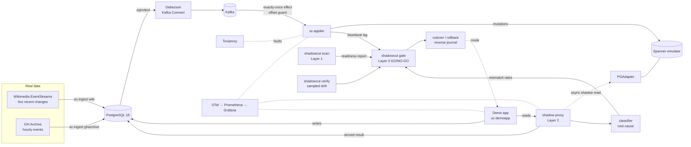

# Shadowcut

**Shadowcut finds every place where Spanner's PostgreSQL interface behaves differently from real
PostgreSQL *for a specific application*, before that app switches databases.**

Teams moving a Postgres app to Spanner's PostgreSQL interface expect it to "just work" because the
SQL looks the same. But Spanner is a different system underneath: some queries silently return
different rows, in a different order, in a different time zone, or fail outright. Shadowcut finds
those places statically, proves them with live shadow reads, explains each one by root cause,
and gates the cutover on the evidence.

| Tool | Question it answers |
|---|---|
| Spanner migration tool (formerly HarbourBridge) | "Can I move my schema and data?" |
| Data Validation Tool (DVT) | "Do the rows match?" |
| **Shadowcut** | **"Will my app behave the same, and if not, where and why?"** |

Shadowcut builds on those tools rather than replacing them. The data migration is the *test setup*,
not the product.

<!-- RESULTS -->

## Architecture



The three layers:

1. **`shadowcut scan`** (before migration): reads the schema and the app's SQL (annotated files,
   JSONL query logs, or `pg_stat_statements`) and writes a readiness report. Each finding has a
   rule, severity, location, explanation, fix, and source. 24 rules
   ([docs/HAZARDS.md](docs/HAZARDS.md)), driven by documentation and a 147-probe experiment
   run on both engines.
2. **`shadowcut shadow proxy | replay`** (during migration): a PostgreSQL wire-protocol proxy
   serves reads from Postgres untouched, runs the same statement on Spanner asynchronously,
   compares the results (order-sensitive or multiset), and classifies every mismatch:
   collation, NULL ordering, NULL semantics, function semantics, precision, time zone,
   nondeterministic order, isolation, replication lag, missing row, unsupported, or other. It
   uses rechecks after the lag bound and a counterfactual re-execution in Spanner's default
   time zone.
3. **`shadowcut gate`** (at switch time): combines mismatch rates per category, replication lag
   and CDC liveness, verifier drift, and unresolved high-severity hazards into **GO / NO-GO**
   with reasons. **`shadowcut cutover`** freezes writes, waits for the CDC drain, checks row
   counts, and switches. **`shadowcut rollback`** replays the transactional reverse journal into
   Postgres. Both are tested, crash-resumable, and idempotent.

Optional Layer 4: `shadowcut explain` explains each mismatch in plain language and proposes a
SQL rewrite when one exists. It uses a deterministic mock locally; Vertex AI Gemini sits behind
`--explainer vertex`. `--eval` re-runs each rewrite on both engines.

## Tech stack

| Area | Choice |
|---|---|
| Language | Go 1.26+ (services, proxy, CLI with cobra) |
| Source | PostgreSQL 16 (Docker) |
| Target | Spanner **PostgreSQL interface** via PGAdapter; Spanner emulator locally |
| CDC | Debezium 3.0 (pgoutput) → Apache Kafka 3.9 (KRaft) → Go applier (Spanner mutations) |
| Managed baseline | Spanner migration tool / Datastream: pending cloud experiment |
| Proxy / API | Go, pgx v5, pgproto3 |
| Testing | Go unit + integration tests, property-based tests (pgregory.net/rapid), testcontainers-go |
| Faults | `docker kill` / pause, Toxiproxy (link cuts and latency) |
| Load | k6 (Experiment 2), Go probe writer (Experiment 4), hotspot benchmark (Experiment 3) |
| Observability | OpenTelemetry metrics → Prometheus → Grafana (provisioned dashboard) |
| Infra | Docker Compose; Terraform for Cloud Run + Cloud SQL + Spanner (**written, not applied**) |
| CI | GitHub Actions: gofmt, vet, golangci-lint, unit/property tests, integration tests on the emulator |

## Quick start

```bash
cp .env.example .env            # set WIKI_UA_CONTACT (Wikimedia User-Agent policy)
OBS=1 ./scripts/up.sh           # Postgres, emulator+PGAdapter, Kafka, Debezium, applier, live ingest, Grafana

# Layer 1: readiness report for the demo app
go run ./cmd/shadowcut scan --json state/scan.json --markdown state/scan.md

# Layer 2: shadow reads (proxy in front of Postgres; point the app's read DSN at :15435)
go run ./cmd/shadowcut shadow proxy --listen :15435
go run ./cmd/shadowcut shadow replay --queries queries/hazards.sql   # or replay a curated set

# drift checking, gate, cutover, rollback
go run ./cmd/shadowcut verify --sample 0.05 --interval 10s
go run ./cmd/shadowcut gate
go run ./cmd/shadowcut cutover          # refuses unless the gate says GO (--force records an override)
go run ./cmd/shadowcut rollback

# experiments
go run ./cmd/sc-exp probe | exp1 | exp4 | exp5 | isolation ; ./scripts/exp2.sh
```

Ports: Postgres 15432, PGAdapter 15433, shadow proxy 15435, demo app 18080, Kafka 19094,
Connect 18083, Toxiproxy 18474, Prometheus 19090, Grafana 13000.

## Documentation

- [docs/HAZARDS.md](docs/HAZARDS.md): hazard catalog, each rule linked to its source
- [docs/EXPERIMENTS.md](docs/EXPERIMENTS.md): method, setup, results, charts, limitations
- [docs/DECISIONS.md](docs/DECISIONS.md): ADRs · [docs/TRADEOFFS.md](docs/TRADEOFFS.md) · [docs/BUGS.md](docs/BUGS.md)
- [PROGRESS.md](PROGRESS.md): build log and next steps
