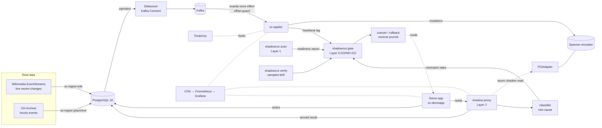

# Shadowcut

**Shadowcut finds every place where Spanner's PostgreSQL interface behaves differently from real
PostgreSQL *for a specific application*, before that app switches databases.**

Teams moving a Postgres app to Spanner's PostgreSQL interface expect it to "just work" because the
SQL looks the same. But Spanner is a different system underneath: some queries silently return
different rows, in a different order, in a different time zone, or fail outright. Shadowcut finds
those places statically, proves them with live shadow reads, explains each one by root cause,
and gates the cutover on the evidence.

| Tool | Question it answers |
|---|---|
| Spanner migration tool (formerly HarbourBridge) | "Can I move my schema and data?" |
| Data Validation Tool (DVT) | "Do the rows match?" |
| **Shadowcut** | **"Will my app behave the same, and if not, where and why?"** |

Shadowcut builds on those tools rather than replacing them. The data migration is the *test setup*,
not the product.

## Headline results (local, emulator)

All numbers are from runs in this repository (raw output in `results/`, method in
[docs/EXPERIMENTS.md](docs/EXPERIMENTS.md)). The target was the **Spanner emulator** behind
PGAdapter, **not real Spanner**. The source was live Wikipedia edits (~17/s) plus 40k GH Archive events.

| | result |
|---|---|
| **Scanner accuracy (Exp 1)** | precision **0.73**, recall **1.00** over 61 statements (37 TP, 14 FP, 0 FN), versus 0.77 / 0.79 for the author's own hand-written expectations. Every FP was a data-dependent hazard the snapshot didn't trigger. |
| **Live parity (Exp 2)** | **79% of 678 shadowed live reads differed.** Causes: replication lag 23%, ties 13%, emulator timeouts 13%, collation 13%, time zone 5%, unsupported 4%, unattributed 4%. App latency unaffected (p50 3.6 ms). |
| **Faults (Exp 4)** | 6 fault scenarios + crash mid-cutover: **0 lost writes, 0 duplicate effects** (Debezium redelivered up to 114 records per Connect crash; all absorbed). Applier recovery after a kill **1.4 s** (30.1 s before static membership). Gate: **0 unsafe GO samples** against independent ground truth (10 before BUG-005). |
| **Cutover / rollback** | write freeze **3.5 s** (70 s before BUG-003); both crash-resumable; rollback replays the reverse journal exactly once. |
| **Verification (Exp 5)** | Injected drift (5 rows, 40k-row table) was always found with **0 false reports** across 148 rounds. Rows read per round scale linearly with the sampling rate (~1,600 per 1%), while total rows read to find all drift stayed in the same range (63k–139k) from 1% to 30%, as theory predicts. One trial per rate (emulator speed), so the timings are anecdotal. |
| **Feature probe** | 147 probes: 21 differ, 53 rejected. Text sorts by code point; `concat()` NULLs; `upper('straße')`; `round(2.5)`; date functions in **America/Los_Angeles** even though `SHOW timezone` = UTC. |
| **Isolation** | 24 concurrent read-modify-writes: Postgres READ COMMITTED **silently lost 19**; Spanner lost 0 but aborted conflicting transactions (the app must retry). |
| **Disaster recovery** | Spanner target rebuilt from Kafka's CDC history: **688,891 records in 140 s**, row counts equal. |

What the live data says about a real app, in one line each:
- **Collation:** A–Z browse (`pages_alpha`) and editor lists return different rows (`Ö` sorts as `O` in Postgres, after `Z` in Spanner).
- **Ties:** "top N" lists (`top_pages`, `gh_top_repos`) break ties differently, so add a unique tiebreaker.
- **Time zones:** daily buckets shift by 8 h (`date_trunc` defaults to Los Angeles).
- **Unsupported:** keyset pagination with a row comparison fails outright on Spanner.
- **Hotspot fix side effect:** after switching to bit-reversed keys or UUIDs, `ORDER BY id DESC` stops meaning "newest" (95% → 0%).

## Architecture



The three layers:

1. **`shadowcut scan`** (before migration): reads the schema and the app's SQL (annotated files,
   JSONL query logs, or `pg_stat_statements`) and writes a readiness report. Each finding has a
   rule, severity, location, explanation, fix, and source. 25 rules
   ([docs/HAZARDS.md](docs/HAZARDS.md)), driven by documentation and a 147-probe experiment
   run on both engines.
2. **`shadowcut shadow proxy | replay`** (during migration): a PostgreSQL wire-protocol proxy
   serves reads from Postgres untouched, runs the same statement on Spanner asynchronously,
   compares the results (order-sensitive or multiset), and classifies every mismatch:
   collation, NULL ordering, NULL semantics, function semantics, precision, time zone,
   nondeterministic order, isolation, replication lag, missing row, unsupported, or other. It
   uses rechecks after the lag bound and a counterfactual re-execution in Spanner's default
   time zone.
3. **`shadowcut gate`** (at switch time): combines mismatch rates per category, replication lag
   and CDC liveness, verifier drift, and unresolved high-severity hazards into **GO / NO-GO**
   with reasons. **`shadowcut cutover`** freezes writes, waits for the CDC drain, checks row
   counts, and switches. **`shadowcut rollback`** replays the transactional reverse journal into
   Postgres. Both are tested, crash-resumable, and idempotent.

Optional Layer 4: `shadowcut explain` explains each mismatch in plain language and proposes a
SQL rewrite when one exists. It uses a deterministic mock locally; Vertex AI Gemini sits behind
`--explainer vertex`. `--eval` re-runs each rewrite on both engines.

## Tech stack

| Area | Choice |
|---|---|
| Language | Go 1.26+ (services, proxy, CLI with cobra) |
| Source | PostgreSQL 16 (Docker) |
| Target | Spanner **PostgreSQL interface** via PGAdapter; Spanner emulator locally |
| CDC | Debezium 3.0 (pgoutput) → Apache Kafka 3.9 (KRaft) → Go applier (Spanner mutations) |
| Proxy / API | Go, pgx v5, pgproto3 |
| Testing | Go unit + integration tests, property-based tests (pgregory.net/rapid), testcontainers-go |
| Faults | `docker kill` / pause, Toxiproxy (link cuts and latency) |
| Load | k6 (Experiment 2), Go probe writer (Experiment 4), hotspot benchmark (Experiment 3) |
| Observability | OpenTelemetry metrics → Prometheus → Grafana (provisioned dashboard) |
| Infra | Docker Compose; Terraform for Cloud Run + Cloud SQL + Spanner |
| CI | GitHub Actions: gofmt, vet, golangci-lint, unit/property tests, integration tests on the emulator |

## Quick start

```bash
cp .env.example .env            # set WIKI_UA_CONTACT (Wikimedia User-Agent policy)
OBS=1 ./scripts/up.sh           # Postgres, emulator+PGAdapter, Kafka, Debezium, applier, live ingest, Grafana

# Layer 1: readiness report for the demo app
go run ./cmd/shadowcut scan --json state/scan.json --markdown state/scan.md

# Layer 2: shadow reads (proxy in front of Postgres; point the app's read DSN at :15435)
go run ./cmd/shadowcut shadow proxy --listen :15435
go run ./cmd/shadowcut shadow replay --queries queries/hazards.sql   # or replay a curated set

# drift checking, gate, cutover, rollback
go run ./cmd/shadowcut verify --sample 0.05 --interval 10s
go run ./cmd/shadowcut gate
go run ./cmd/shadowcut cutover          # refuses unless the gate says GO (--force records an override)
go run ./cmd/shadowcut rollback

# experiments
go run ./cmd/sc-exp probe | exp1 | exp4 | exp5 | isolation ; ./scripts/exp2.sh
```

Ports: Postgres 15432, PGAdapter 15433, shadow proxy 15435, demo app 18080, Kafka 19094,
Connect 18083, Toxiproxy 18474, Prometheus 19090, Grafana 13000.

## Documentation

- [docs/HAZARDS.md](docs/HAZARDS.md): hazard catalog, each rule linked to its source
- [docs/EXPERIMENTS.md](docs/EXPERIMENTS.md): method, setup, results, charts, limitations
- [docs/DECISIONS.md](docs/DECISIONS.md): ADRs · [docs/TRADEOFFS.md](docs/TRADEOFFS.md) · [docs/BUGS.md](docs/BUGS.md)
- [docs/PROGRESS.md](docs/PROGRESS.md): build log and next steps

## Considered and set aside

- **A full SQL parser (pg_query_go).** It needs cgo, which complicates Windows/CI builds. A correct lexer
  plus structural analysis covers every rule (ADR-005); the limits are listed below.
- **Only a library wrapper inside the app.** It only works for Go apps. The wire proxy works for
  any client (ADR-003); replay covers offline logs.
- **Writing CDC through PGAdapter (`INSERT … ON CONFLICT`).** It works on the emulator, but
  mutations are what managed tools use, and they batch better (ADR-002).
- **Dual writes for rollback.** Two commits can diverge. A reverse journal written in the same Spanner
  transaction is atomic (ADR-011).
- **Reverse CDC with change streams for rollback.** More general, but a second pipeline; noted as
  the production upgrade path.
- **YCSB / TPC-C as the controlled benchmark.** YCSB's Spanner binding targets the GoogleSQL native
  API rather than the PostgreSQL interface, and needs a Java/Maven build. TPC-C's schema leans on
  sequential keys and SELECT … FOR UPDATE patterns that would mostly re-measure known hazards.
  Instead: k6 against the demo app (Experiment 2), a fixed-rate probe writer (Experiment 4), and a
  purpose-built hotspot benchmark (Experiment 3).
- **Hiding float differences with a tolerance.** Rejected: an app that prints `0.15000000000000002`
  vs `0.15` does behave differently. Tolerance is used only to *explain* a mismatch as precision
  (ADR-004).

## Where Shadowcut fails

- **It only sees the queries it is shown.** Code paths that never ran, and dynamic SQL that never hit the proxy, are invisible.
- **Data-dependent hazards need the data.** 14 of 51 scored scanner predictions were never observed in Experiment 1; shadow reads show whether *this* data triggers a risk.
- **The emulator is not Spanner.** No splits, hotspots, or realistic latency, and it may differ in behaviour. Every finding is labelled emulator.

Full list of limits: [docs/LIMITATIONS.md](docs/LIMITATIONS.md).

## Lessons

1. **Measure gates against independent ground truth.** Counting acknowledged rows missing in Spanner exposed two real gate bugs that a "should say NO-GO" assertion missed (BUG-005).
2. **A heartbeat is per-partition truth, not pipeline truth.** Measure CDC lag on the partition furthest behind.
3. **Defaults dominate recovery times.** Kafka Connect's offset flush and the consumer session timeout made freeze and restart far slower than needed (BUG-003).
4. **Most behavioural differences are boring and systematic:** collation, ties, unsupported syntax, and time zones. Fixable once named precisely.
5. **Evidence beats memory, and live data is a race.** Several "known" facts were wrong on the emulator, and without bracketed rechecks live recall fell from 1.00 to 0.67.
