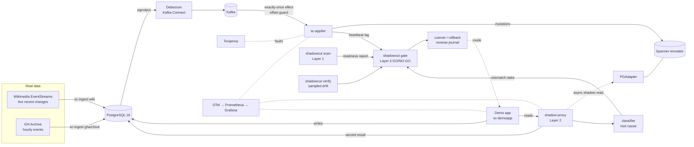

# Shadowcut

**Shadowcut finds every place where Spanner's PostgreSQL interface behaves differently from real
PostgreSQL *for a specific application*, before that app switches databases.**

Teams moving a Postgres app to Spanner's PostgreSQL interface expect it to "just work" because the
SQL looks the same. But Spanner is a different system underneath: some queries silently return
different rows, in a different order, in a different time zone, or fail outright. Shadowcut finds
those places statically, proves them with live shadow reads, explains each one by root cause,
and gates the cutover on the evidence.

| Tool | Question it answers |
|---|---|
| Spanner migration tool (formerly HarbourBridge) | "Can I move my schema and data?" |
| Data Validation Tool (DVT) | "Do the rows match?" |
| **Shadowcut** | **"Will my app behave the same, and if not, where and why?"** |

Shadowcut builds on those tools rather than replacing them. The data migration is the *test setup*,
not the product.

## Headline results (local, emulator)

All numbers are from runs in this repository (raw output in `results/`, method in
[docs/EXPERIMENTS.md](docs/EXPERIMENTS.md)). The target was the **Spanner emulator** behind
PGAdapter, **not real Spanner**. The source was live Wikipedia edits (~17/s) plus 40k GH Archive events.

| | result |
|---|---|
| **Scanner accuracy (Exp 1)** | precision **0.73**, recall **1.00** over 61 statements (37 TP, 14 FP, 0 FN), versus 0.77 / 0.79 for the author's own hand-written expectations. Every FP was a data-dependent hazard the snapshot didn't trigger. |
| **Live parity (Exp 2)** | **79% of 678 shadowed live reads differed.** Causes: replication lag 23%, ties 13%, emulator timeouts 13%, collation 13%, time zone 5%, unsupported 4%, unattributed 4%. App latency unaffected (p50 3.6 ms). |
| **Faults (Exp 4)** | 6 fault scenarios + crash mid-cutover: **0 lost writes, 0 duplicate effects** (Debezium redelivered up to 114 records per Connect crash; all absorbed). Applier recovery after a kill **1.4 s** (30.1 s before static membership). Gate: **0 unsafe GO samples** against independent ground truth (10 before BUG-005). |
| **Cutover / rollback** | write freeze **3.5 s** (70 s before BUG-003); both crash-resumable; rollback replays the reverse journal exactly once. |
| **Verification (Exp 5)** | see below |
| **Feature probe** | 147 probes: 21 differ, 53 rejected. Text sorts by code point; `concat()` NULLs; `upper('straße')`; `round(2.5)`; date functions in **America/Los_Angeles** even though `SHOW timezone` = UTC. |
| **Isolation** | 24 concurrent read-modify-writes: Postgres READ COMMITTED **silently lost 19**; Spanner lost 0 but aborted conflicting transactions (the app must retry). |
| **Disaster recovery** | Spanner target rebuilt from Kafka's CDC history: **688,891 records in 140 s**, row counts equal. |

What the live data says about a real app, in one line each:
- **Collation:** A–Z browse (`pages_alpha`) and editor lists return different rows (`Ö` sorts as `O` in Postgres, after `Z` in Spanner).
- **Ties:** "top N" lists (`top_pages`, `gh_top_repos`) break ties differently, so add a unique tiebreaker.
- **Time zones:** daily buckets shift by 8 h (`date_trunc` defaults to Los Angeles).
- **Unsupported:** keyset pagination with a row comparison fails outright on Spanner.
- **Hotspot fix side effect:** after switching to bit-reversed keys or UUIDs, `ORDER BY id DESC` stops meaning "newest" (95% → 0%).

## Architecture



The three layers:

1. **`shadowcut scan`** (before migration): reads the schema and the app's SQL (annotated files,
   JSONL query logs, or `pg_stat_statements`) and writes a readiness report. Each finding has a
   rule, severity, location, explanation, fix, and source. 24 rules
   ([docs/HAZARDS.md](docs/HAZARDS.md)), driven by documentation and a 147-probe experiment
   run on both engines.
2. **`shadowcut shadow proxy | replay`** (during migration): a PostgreSQL wire-protocol proxy
   serves reads from Postgres untouched, runs the same statement on Spanner asynchronously,
   compares the results (order-sensitive or multiset), and classifies every mismatch:
   collation, NULL ordering, NULL semantics, function semantics, precision, time zone,
   nondeterministic order, isolation, replication lag, missing row, unsupported, or other. It
   uses rechecks after the lag bound and a counterfactual re-execution in Spanner's default
   time zone.
3. **`shadowcut gate`** (at switch time): combines mismatch rates per category, replication lag
   and CDC liveness, verifier drift, and unresolved high-severity hazards into **GO / NO-GO**
   with reasons. **`shadowcut cutover`** freezes writes, waits for the CDC drain, checks row
   counts, and switches. **`shadowcut rollback`** replays the transactional reverse journal into
   Postgres. Both are tested, crash-resumable, and idempotent.

Optional Layer 4: `shadowcut explain` explains each mismatch in plain language and proposes a
SQL rewrite when one exists. It uses a deterministic mock locally; Vertex AI Gemini sits behind
`--explainer vertex`. `--eval` re-runs each rewrite on both engines.

## Tech stack

| Area | Choice |
|---|---|
| Language | Go 1.26+ (services, proxy, CLI with cobra) |
| Source | PostgreSQL 16 (Docker) |
| Target | Spanner **PostgreSQL interface** via PGAdapter; Spanner emulator locally |
| CDC | Debezium 3.0 (pgoutput) → Apache Kafka 3.9 (KRaft) → Go applier (Spanner mutations) |
| Managed baseline | Spanner migration tool / Datastream: pending cloud experiment |
| Proxy / API | Go, pgx v5, pgproto3 |
| Testing | Go unit + integration tests, property-based tests (pgregory.net/rapid), testcontainers-go |
| Faults | `docker kill` / pause, Toxiproxy (link cuts and latency) |
| Load | k6 (Experiment 2), Go probe writer (Experiment 4), hotspot benchmark (Experiment 3) |
| Observability | OpenTelemetry metrics → Prometheus → Grafana (provisioned dashboard) |
| Infra | Docker Compose; Terraform for Cloud Run + Cloud SQL + Spanner (**written, not applied**) |
| CI | GitHub Actions: gofmt, vet, golangci-lint, unit/property tests, integration tests on the emulator |

## Quick start

```bash
cp .env.example .env            # set WIKI_UA_CONTACT (Wikimedia User-Agent policy)
OBS=1 ./scripts/up.sh           # Postgres, emulator+PGAdapter, Kafka, Debezium, applier, live ingest, Grafana

# Layer 1: readiness report for the demo app
go run ./cmd/shadowcut scan --json state/scan.json --markdown state/scan.md

# Layer 2: shadow reads (proxy in front of Postgres; point the app's read DSN at :15435)
go run ./cmd/shadowcut shadow proxy --listen :15435
go run ./cmd/shadowcut shadow replay --queries queries/hazards.sql   # or replay a curated set

# drift checking, gate, cutover, rollback
go run ./cmd/shadowcut verify --sample 0.05 --interval 10s
go run ./cmd/shadowcut gate
go run ./cmd/shadowcut cutover          # refuses unless the gate says GO (--force records an override)
go run ./cmd/shadowcut rollback

# experiments
go run ./cmd/sc-exp probe | exp1 | exp4 | exp5 | isolation ; ./scripts/exp2.sh
```

Ports: Postgres 15432, PGAdapter 15433, shadow proxy 15435, demo app 18080, Kafka 19094,
Connect 18083, Toxiproxy 18474, Prometheus 19090, Grafana 13000.

## Documentation

- [docs/HAZARDS.md](docs/HAZARDS.md): hazard catalog, each rule linked to its source
- [docs/EXPERIMENTS.md](docs/EXPERIMENTS.md): method, setup, results, charts, limitations
- [docs/DECISIONS.md](docs/DECISIONS.md): ADRs · [docs/TRADEOFFS.md](docs/TRADEOFFS.md) · [docs/BUGS.md](docs/BUGS.md)
- [PROGRESS.md](PROGRESS.md): build log and next steps
## Pending cloud experiments

No cloud resources were created. Everything below is written and ready, but **not run**.
Terraform (`terraform/`) creates: a Spanner instance (1,000 PU, PostgreSQL-dialect database),
Cloud SQL for PostgreSQL 16 with logical decoding, Artifact Registry, and Cloud Run (demo app with
PGAdapter and shadow-proxy sidecars, plus an experiment job). `terraform validate` passes.
The runbook is `scripts/cloud/run-pending.sh` (each step prints what it does).

| experiment | why it needs real Spanner | command | est. cost |
|---|---|---|---|
| **Exp 3: hotspotting** (sequential vs bit-reversed vs UUID) | the emulator has no splits/hotspots | `PROJECT=<id> scripts/cloud/run-pending.sh exp3` | ~$1 (2 min × 3 strategies on 1 node, within the session below) |
| **Emulator confirmations**: re-run the 147-probe experiment and Exp 1 on real Spanner; diff the results | NULL ordering, `ILIKE`, time-zone defaults, window functions, function support may differ from the emulator | `PROJECT=<id> scripts/cloud/run-pending.sh confirm` | <$1 |
| **Managed baseline**: Spanner migration tool (Datastream + Dataflow) vs Debezium → Kafka → applier on the same Cloud SQL source; lag, lost/duplicate rows, verifier drift | managed services are cloud-only | `PROJECT=<id> scripts/cloud/run-pending.sh baseline` | ~$3 (Datastream ~$2/GB, 2 Dataflow workers ~2 h) |
| **Shadow throughput on real Spanner** (Exp 2 on Cloud Run) | emulator speed capped shadowing at ~1 query/s and caused the timeouts | deploy via `infra`, then point k6 at the Cloud Run URL | included |
| **Layer 4 with Gemini**: `shadowcut explain --explainer vertex --eval` | needs Vertex AI credentials | `shadowcut explain --explainer vertex --project <id> --mismatches results/exp1/outcomes.json --eval` | cents |
| **YCSB (Spanner binding)** as a third-party controlled benchmark | GoogleSQL native API; useful as an external reference point | see `scripts/cloud/run-pending.sh` notes | ~$1 |

**One ~4-hour session for all of the above: about $8–12 at list prices** (Spanner 1 node ≈ $0.90/h,
Cloud SQL 2 vCPU ≈ $0.13/h, Datastream/Dataflow ≈ $3, Cloud Run and registry < $1. Verify current
pricing.) Run `scripts/cloud/run-pending.sh destroy` afterwards.

## Considered and set aside

- **A full SQL parser (pg_query_go).** It needs cgo, which complicates Windows/CI builds. A correct lexer
  plus structural analysis covers every rule (ADR-005); the limits are listed below.
- **Only a library wrapper inside the app.** It only works for Go apps. The wire proxy works for
  any client (ADR-003); replay covers offline logs.
- **Writing CDC through PGAdapter (`INSERT … ON CONFLICT`).** It works on the emulator, but
  mutations are what managed tools use, and they batch better (ADR-002).
- **Dual writes for rollback.** Two commits can diverge. A reverse journal written in the same Spanner
  transaction is atomic (ADR-011).
- **Reverse CDC with change streams for rollback.** More general, but a second pipeline; noted as
  the production upgrade path.
- **YCSB / TPC-C as the controlled benchmark.** YCSB's Spanner binding targets the GoogleSQL native
  API rather than the PostgreSQL interface, and needs a Java/Maven build. TPC-C's schema leans on
  sequential keys and SELECT … FOR UPDATE patterns that would mostly re-measure known hazards.
  Instead: k6 against the demo app (Experiment 2), a fixed-rate probe writer (Experiment 4), and a
  purpose-built hotspot benchmark (Experiment 3). Running YCSB against real Spanner is listed with
  the pending cloud work.
- **Hiding float differences with a tolerance.** Rejected: an app that prints `0.15000000000000002`
  vs `0.15` does behave differently. Tolerance is used only to *explain* a mismatch as precision
  (ADR-004).

## Where Shadowcut fails

Honest limits, most of them measured:

- **It only sees the queries it is shown.** The scanner reads files, logs, and
  `pg_stat_statements`; the proxy sees live reads. Code paths that never ran and dynamic SQL built at
  runtime that never hit the proxy are invisible.
- **Data-dependent hazards need the data.** In Experiment 1, 14 of 51 scored scanner predictions were
  never observed. Unicode case mapping needs a `ß` or `İ` in the data; `::date` needs rows near midnight
  in Los Angeles time; ties need equal sort keys. The scanner flags the *risk*; shadow reads show
  whether *this* data triggers it.
- **Aggregates over a text range cannot be attributed from rows alone.** `count(*) WHERE title > 'M'`
  differs because the WHERE clause collates differently. The classifier now infers collation from
  the predicate structure, at medium confidence.
- **Live data makes classification probabilistic.** Bracketed rechecks separate churn from behaviour,
  but in Experiment 2 about 5% of live mismatches stayed `other` (mixed causes, fast-moving aggregates).
- **Isolation differences are mostly invisible to shadow reads.** A read inside a Postgres
  transaction that already wrote is flagged as `isolation`, but lost updates under READ COMMITTED
  only show up in a concurrency test (`sc-exp isolation`), not by comparing results.
- **Shadow throughput is limited** by the target's query speed and by rechecks. On the emulator only
  about 8% of reads were shadowed (the rest were counted as dropped). Evidence is a sample, and the
  gate warns about it.
- **The cutover freeze must be honoured by every writer.** Writers outside the app, such as the live
  ingestor, must be stopped separately. The final count check catches the case where they are not
  (it did, once: BUG-006).
- **Rollback only replays what the app journaled.** Writes made to Spanner outside the app's write
  path are not rolled back.
- **The emulator is not Spanner.** It has no splits, hotspots, or realistic latency. It allows one
  read-write transaction at a time (app writes in Spanner mode took 1.7–60 s while CDC applied), and
  it may differ in behaviour, for example `ILIKE` being accepted. Every finding is labelled emulator.
- **The lexer-based scanner approximates scopes.** Nested subqueries with re-used aliases, or a text
  column reached only through a derived table, can be missed. Columns with the same name in joined
  tables can be over-reported.

## Lessons

1. **Measure gates against independent ground truth.** Asserting "the gate should say NO-GO in this
   scenario" passed while the gate was unsafe. Counting acknowledged rows missing in Spanner at each
   sample exposed two real bugs (BUG-005): a fresh heartbeat hid a data backlog, and a silent connector
   produced no backlog at all.
2. **A heartbeat is per-partition truth, not pipeline truth.** CDC lag must be measured on the partition
   that is furthest behind, and while the source connector is down, the heartbeat's age bounds the lag.
3. **Defaults dominate recovery times.** Kafka Connect's 60 s offset flush made the cutover freeze 70 s
   (BUG-003 → 3.5 s). The consumer session timeout made applier restarts take 30 s (static membership
   → 1.4 s).
4. **Most behavioural differences are boring and systematic.** On live traffic, the biggest real causes
   were collation, ties, unsupported syntax and time zones. These are fixable in the app once they are
   named precisely.
5. **Evidence beats memory.** Several "known" facts were wrong on the emulator: NULL ordering matches
   Postgres; `ILIKE` works; `round(float8)` rounds 2.5 to 3. The scanner's function rules come from a
   147-probe experiment, not from recollection.
6. **Live data turns every comparison into a race.** Without bracketing and counterfactuals, live
   replay recall fell from 1.00 (static snapshot) to 0.67, because unexplained churn swamped real causes.
7. **Never freeze a process that holds a database transaction.** `docker pause` on the applier left the
   emulator's only write slot held forever (BUG-009). Kafka's retained CDC history turned that into a
   2-minute rebuild instead of a re-migration.
8. **SQL name resolution bites test harnesses too.** `SELECT id::text … ORDER BY id` sorts by the text
   output column (BUG-010). The same rule decides what an app's ORDER BY really means after a type change.
